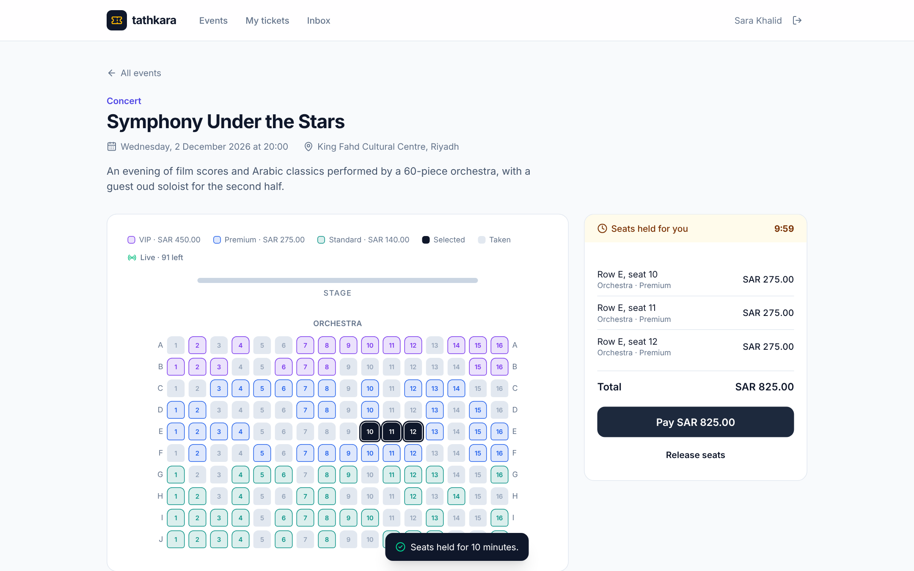
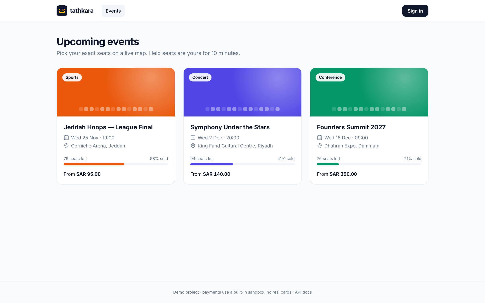
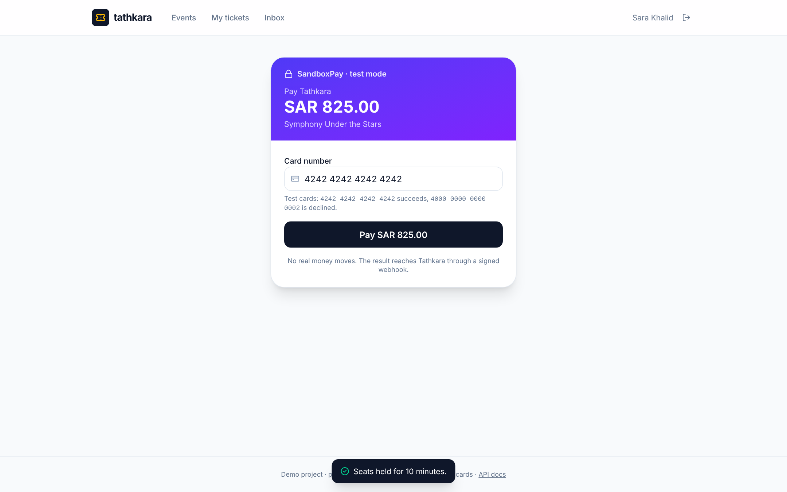
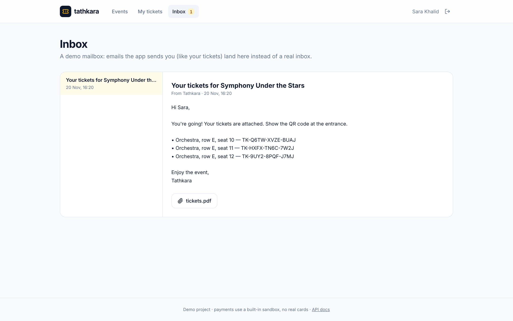
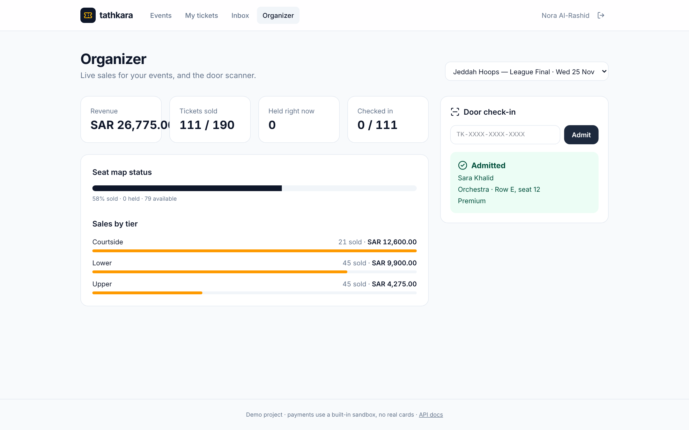
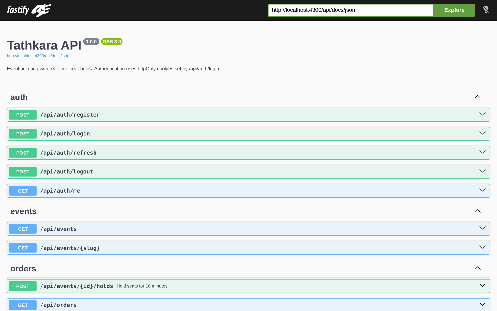
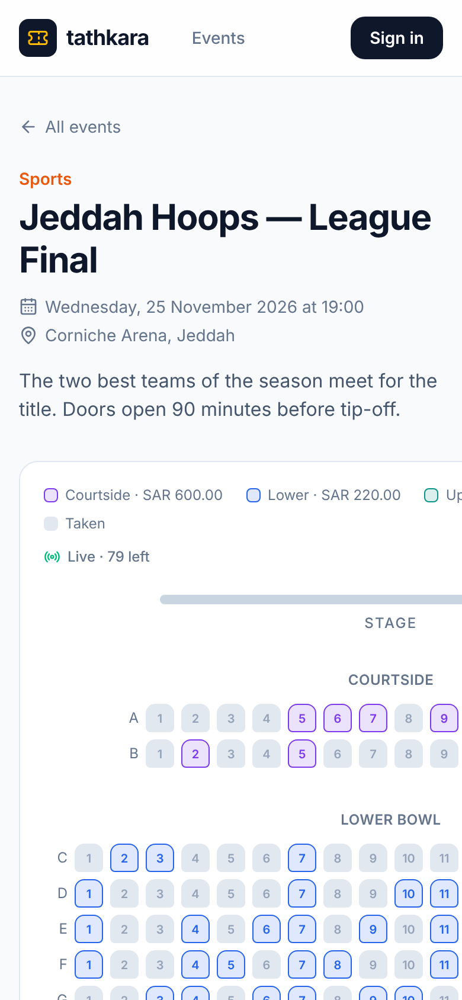

# Tathkara — real-time event ticketing (React + Node.js)

[](https://github.com/Mohsen-Hussen/tathkara/actions/workflows/ci.yml)


**Tathkara** (تذكرة, "ticket") lets people pick exact seats on a live map, hold them for 10 minutes, pay
through a hosted checkout and get PDF tickets with QR codes by email. Organizers see sales live and admit
people at the door with a scanner.

The interesting part is the **Node.js backend**. It has to stay correct when many people grab the same seat
at once, when a payment arrives late or twice, and when background jobs retry.

**Live demo:** _coming soon_. Demo accounts use the password `demo1234`:

| Account             | Role                                        |
| ------------------- | ------------------------------------------- |
| `ali@tathkara.app`  | Customer                                    |
| `sara@tathkara.app` | Customer                                    |
| `nora@tathkara.app` | Organizer (sales dashboard + door check-in) |

Payments use a built-in sandbox: `4242 4242 4242 4242` succeeds and `4000 0000 0000 0002` is declined.



<table>
  <tr>
    <td></td>
    <td></td>
  </tr>
  <tr>
    <td></td>
    <td></td>
  </tr>
  <tr>
    <td></td>
    <td align="center"></td>
  </tr>
</table>

## Backend highlights

| Problem                                    | How it's solved                                                                                                                                                                                                                                                                                                                                                |
| ------------------------------------------ | -------------------------------------------------------------------------------------------------------------------------------------------------------------------------------------------------------------------------------------------------------------------------------------------------------------------------------------------------------------- |
| **50 people click the same seat**          | The hold runs in one transaction that locks the seats with `SELECT … FOR UPDATE`, always in seat-id order so two buyers can never deadlock. Exactly one buyer gets the seat; the rest get `409` with the ids that were taken. A test fires 50 concurrent requests to prove it.                                                                                 |
| **Holds that are never paid**              | The 10-minute expiry job is queued with **pg-boss** _inside the same transaction_ as the hold (transactional outbox). If the hold rolls back, the job never exists. The job is idempotent, so retries are harmless.                                                                                                                                            |
| **Trusting payments**                      | The browser never marks an order as paid. A sandbox provider (shaped like Stripe Checkout) sends a **signed webhook**. The API checks the HMAC-SHA256 signature with a constant-time compare, rejects anything older than 5 minutes, and records each event id. A replayed webhook is a no-op.                                                                 |
| **Payment arrives after the hold expired** | The order is marked expired, the seats stay released, and the customer gets a refund email instead of tickets for seats someone else may now own.                                                                                                                                                                                                              |
| **Sessions**                               | Short-lived JWT access tokens and **rotating refresh tokens** sit in `httpOnly`, `SameSite=Strict` cookies. If a refresh token is used twice, it was stolen, so the whole login family is revoked. Passwords use scrypt, and login is rate-limited. An unknown email and a wrong password get the same response, so attackers can't tell which accounts exist. |
| **Real-time**                              | Socket.IO rooms per event push seat status changes to every viewer. The payload never says _who_ holds a seat.                                                                                                                                                                                                                                                 |
| **Background work**                        | After payment, a job renders A6 ticket PDFs with QR codes (pdfkit + qrcode) and emails them. A dedupe key makes retries safe. Email goes to a demo inbox stored in the database, so the demo needs no email provider.                                                                                                                                          |
| **Door check-in**                          | Locks the ticket row, so two gates can't admit the same ticket. Other organizers' tickets look like they don't exist (`404`, not `403`).                                                                                                                                                                                                                       |
| **API contract**                           | Zod schemas in a shared package validate requests, serialize responses (nothing leaks by accident) and generate the **OpenAPI docs** at `/api/docs`. The React app uses the same schemas for its forms.                                                                                                                                                        |
| **Ops**                                    | Structured logging with pino (cookies redacted), Helmet CSP, a health check, graceful shutdown, a multi-stage Dockerfile, and docker-compose.                                                                                                                                                                                                                  |

## Architecture

```
tathkara/
├─ packages/shared/        Zod schemas + types used by both sides (inputs, DTOs, Socket.IO events)
├─ apps/api/               Node.js 22 · Fastify 5 · TypeScript
│  ├─ src/services/        booking (holds, expiry, settlement) · payments · auth · tickets · catalog
│  ├─ src/routes/          thin HTTP layer: schema → service → response
│  ├─ src/jobs/            pg-boss queues and workers
│  ├─ src/realtime/        Socket.IO rooms
│  ├─ src/db/              Drizzle schema, SQL migrations, deterministic seed
│  └─ test/                integration tests against a real PostgreSQL
├─ apps/web/               React 19 · Vite · TanStack Query · React Router · Tailwind CSS
└─ e2e/                    Playwright tests against the production build
```

```
Browser ──HTTP──▶ Fastify routes ──▶ services ──▶ PostgreSQL (row locks, constraints)
   ▲                                     │
   │  Socket.IO "seats:changed"          ├──▶ pg-boss jobs (expire hold, issue tickets) — same database
   └─────────────────────────────────────┘
Sandbox checkout ──signed webhook──▶ /api/webhooks/payments ──▶ settle in one transaction
```

In production the API also serves the built React app, so everything runs on one origin with no CORS setup.
The database protects the invariants itself too: a `CHECK` constraint guarantees a seat has an owning order
exactly when it isn't available, and unique constraints stop a seat from getting two tickets.

## Running locally

**With Docker** (everything included):

```bash
docker compose up --build      # http://localhost:4000 · API docs at /api/docs
```

**For development** (Node 22 + a PostgreSQL):

```bash
npm install
cp .env.example .env           # point DATABASE_URL at your database
npm run build -w @tathkara/shared
npm run db:migrate && npm run db:seed
npm run dev                    # API on :4000, web on :5173 (Vite proxies /api and /socket.io)
```

## Tests

| Command            | What runs                                                                                                                                                          |
| ------------------ | ------------------------------------------------------------------------------------------------------------------------------------------------------------------ |
| `npm test`         | 27 API integration tests against a **real PostgreSQL**, plus 6 web unit tests. Locally it boots an embedded Postgres; in CI it uses a service container.           |
| `npm run test:e2e` | 5 Playwright flows on the production build: buying tickets end to end, live seat updates between two browsers, a declined card, door check-in, and auth redirects. |

API test coverage includes the 50-way race for a single seat, opposite-order locking without deadlocks,
refresh-token reuse detection, webhook signature, replay and idempotency, late payments and refunds,
job idempotency, and per-user access checks. CI runs format, lint and type checks, both test suites, and a
Docker build on every push.

## Deploying

`render.yaml` is a Render Blueprint: a Docker web service plus a PostgreSQL database. Render generates the
JWT and webhook secrets itself. The image works on any container host. Set `DATABASE_URL`, `JWT_SECRET` and
`WEBHOOK_SECRET`.

## License

MIT © Mohsen Hussein
